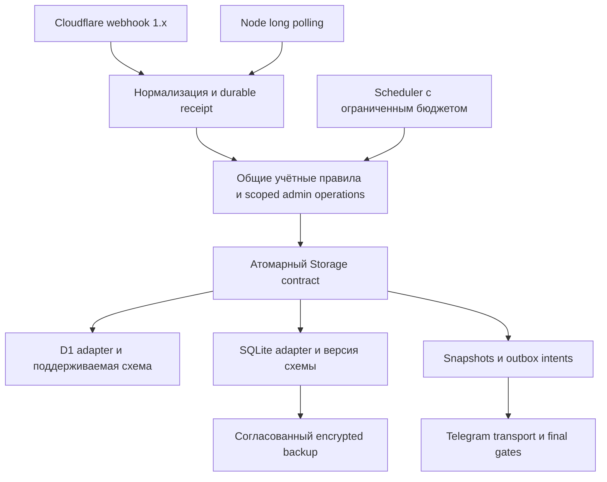

# Sangha-Mantra-Bot — пересмотренный MASTER PLAN

Редакция: 14.11.2026, после независимого review и уточнения владельца. Результат — инженерный план и связанные спецификации. **Product implementation, merge и production не выполняются и этим текстом не разрешаются.** Исходные документы и файл review сохранены без изменений. Разбор review — EV08, а четыре последующих решения владельца — EV09 в [BASELINE_AND_DELTAS](BASELINE_AND_DELTAS.md); EV09 имеет приоритет.

Рекомендация: **стабилизировать Cloudflare 1.x отдельным потоком; 2.0 строить self-hosted-first через общие атомарные контракты, Node/SQLite, затем Multi-Campaign и Telegram Admin UX.** Cloudflare остаётся поддерживаемой 1.x платформой; Cloudflare v2 — опция после отдельного capacity/parity gate. Причины и условия выбора исходного Cloudflare-first вместо этой рекомендации — ADR-01 в [DECISIONS](DECISIONS.md).

Это не вывод «Cloudflare уже не выдерживает»: production CPU/rows/quota evidence отсутствуют. Необходимость постоянно обслуживать Linux-хост — цена self-hosted, а не исчезающая задача. Порядок платформ, эксплуатационные компромиссы и release decisions требует утвердить владелец.

Принято владельцем (EV09): **P0 → проверка → безопасный выпуск и сверка → функциональные улучшения**. D1 → SQLite — самостоятельный мигратор, не prerequisite первого self-hosted релиза с пустой БД. Pause начинает действовать после final confirm/DB commit и не отменяет уже принятые вклады. Provider Time Travel 7 дней для текущего production принят с осознанием ограничений; отдельную регулярную внешнюю backup систему 1.x не разрабатываем.

## Комплект и порядок чтения

| Документ | Назначение |
|---|---|
| [BASELINE_AND_DELTAS](BASELINE_AND_DELTAS.md) | SHA, карта кода, новые/унаследованные доказательства, incident 35, неизвестные факты |
| [DECISIONS](DECISIONS.md) | ADR-01…ADR-09, модель, транзакции, routing/auth, lifecycle, delivery, migration |
| [ADMIN_UX_SPEC](ADMIN_UX_SPEC.md) | Экраны, роли, journeys, callbacks, ошибки и human acceptance |
| [OPERATIONS_SPEC](OPERATIONS_SPEC.md) | Setup, polling, audit/logs, backup, reconciliation, capacity и безопасные переходы |
| [BACKLOG](BACKLOG.md) | Небольшие задачи, зависимости, scope, DoD, риски и legacy T01–T32 mapping |
| [VERIFICATION_MATRIX](VERIFICATION_MATRIX.md) | Требование → ADR → task → сценарий, faults и текущий уровень evidence |
| [SESSION_STATE](SESSION_STATE.md) | Короткий checkpoint и следующий безопасный шаг |

Статусы фактов определены в BASELINE. Ни «предлагается», ни «INHERITED-TEST», ни успешный CI не означают реализованную v2 или production GO.

## Проверенная база и открытые отказы

Public HEAD: b7cc125a47c4b791cdafefcd22dbc1859a8f126f; base main: efc3240e988a6809978339944da09155c256adbb. [PR #1](https://github.com/midnight000spark/Sangha-Mantra-Bot/pull/1) открыт, 2 commits / 47 files, не merged; [CI](https://github.com/midnight000spark/Sangha-Mantra-Bot/actions/runs/43404449402) success; reviews/threads 0 на срезе этой сессии. Локальные product tests не повторялись на неизменном SHA. Прежние 189 tests / 831 assertions, backup drill и build — явно унаследованные свидетельства, не новые результаты.

| Наблюдение | Решение в плане |
|---|---|
| F03: final authorization только для ui: | P0-integrity/security перед merge: все admin responses/exports/intents проверяют актуальный scope |
| F04: старый впервые доставленный OFF снимает новый ON | P0-integrity/security перед merge: dedup + отдельное упорядочение/watermark |
| F05: stale numeric warning после edit | Закрыть в Track A до production; revision fence и regression обязательны |
| F06: SUM на каждом ingest растёт с историей | Измерить; projection delta + reconciliation до подтверждённого роста нагрузки; не выдавать local rows за cloud CPU |
| F01/F02: темы теряются, config/admins глобальны | Требуют отдельного v2 schema/envelope/auth, не расширения maintenance PR |
| F07/F08: fake public guards и Bun operations | Production artifact требует реальной identity; Node release — собственного install/backup evidence |
| Incident 35 / zero overrides 32,38 | Boundary не исправляет уже записанный дубль; никаких предположений об исполнении correction |
| Видимый отчёт + FAILED_KNOWN | Причина UNKNOWN, сначала trace/сверка, затем отдельное решение о доставке |

Production SHA, total, webhook, Cron, real cutoff, backlog и backup freshness неизвестны. Вердикт на текущем HEAD: **NO-GO для merge из-за F03/F04; NO-GO для немедленного production transition; GO только для документационного планирования и независимого review.**

## Scope и требования

Цель — один недорогой бот с независимыми накоплениями в разных группах/темах, точным учётом, понятной админкой и автономным восстановлением. Один instance содержит один bot token и одну БД. Новые кампании имеют один intake source; объединение нескольких групп в одну кампанию, несколько bot tokens/DB, SaaS, рейтинги, web admin, Node webhook, отдельный systemd package и другие мессенджеры не входят в MVP.

P0-I = integrity/security gate, P0-U = product usability gate **для указанного релиза**. Неготовый UX 2.0 не блокирует maintenance 1.x. P1-функции включаются только явным release scope; их внутренние integrity rules обязательны, если функция включена.

| ID | Требование | Обязательность / ADR |
|---|---|---|
| RQ01 | Сохранить согласованный numeric parser; команды, bots/media/captions/forwards не начислять | P0-I обе версии; ADR-02/03 |
| RQ02 | Receipt dedup и один эффект оригинала, atomic replay/crash | P0-I обе; ADR-02 |
| RQ03 | Правки заменяют исходное значение, stale не воскрешает, равные конфликтные версии REVIEW | P0-I обе; ADR-04 |
| RQ04 | Override, включая 0, переживает edits; release использует однозначный source | P0-I обе; ADR-04 |
| RQ05 | Provenance joined_at/boundary/import coverage; pre-boundary edits не создают вклад; UNKNOWN состава legacy import не считается доказанным отсутствием дубля | P0-I 1.x/2.0; ADR-03/04 |
| RQ06 | Exact independent routes, no forum fallback, pinned original identity | P0-I 2.0; ADR-03 |
| RQ07 | Scope на read/write/callback/export/final delivery, revoke и version conflict | P0-I обе в доступных функциях; ADR-05 |
| RQ08 | Silent не pause; ordered commands; OFF не выпускает старые holds | P0-I обе; ADR-07 |
| RQ09 | Immutable snapshot, attempts и честные SENT/FAILED_KNOWN/UNCERTAIN | P0-I обе; ADR-04/07 |
| RQ10 | Bounded calendar scheduler, DST/timezone revisions, без повторного period | P0-I 2.0 и существующий calendar 1.x; ADR-06/09 |
| RQ11 | 1.x D1: выбранные владельцем 7 дней provider PITR и проверенный runbook; v2 Node: consistent encrypted external backup, verified rotation/restore и выбранные RPO/RTO | P0-I соответствующей платформы; ADR-08 |
| RQ12 | Один набор правил, реальные D1/Node contracts, без обязательного Bun у self-host user | P0-I переносимости; ADR-01/02 |
| RQ13 | Один consumer/writer, durable polling ack, webhook exclusivity | P0-I runtime; ADR-09 |
| RQ14 | Измеренный capacity budget, bounded work, reconciliation derived totals | Условный P0-I до cloud scaling; ADR-04/09 |
| RQ15 | Читаемые status/recent/changes; setup и коррекции без SQL/ID | P0-U 2.0; ADR-05/06 |
| RQ16 | Pause только confirm/commit, без отмены прежних вкладов; rename/goal/adjustment/completion/archive и current milestone отдельно | Pause — OWNER-DECIDED EV09; остальные defaults OD02; ADR-04/06 |
| RQ17 | Event contract до ledger/schema; обязательный causal audit с первой transaction и snapshot watermark; позднее UI/trace/export; legacy causality явно partial/unknown | P0-I ledger, P0-U диагностика; ADR-02/04/09 |
| RQ18 | Поправка отчёта объяснима contributing events; updated view отдельно | P0-I/P0-U, минимальный trace 1.x; ADR-04 |
| RQ19 | Реакция после commit, desired-state/version fence, removal/mismatch, silent | Запрос владельца; предлагается P1 с OD05, gate при включении; ADR-07 |
| RQ20 | /progress, /check, /help: exact scope, parser exclusion, rate limit, privacy/silent | /progress цель владельца, /check предложение; P1 с OD06; ADR-03/05/07 |
| RQ21 | Cold install, bootstrap owner, TEST/diagnostics и upgrade без Cloudflare/domain/Bun | P0-U self-hosted release; ADR-02/05/09 |
| RQ22 | Честный fullness_not_verified, gaps, периодная сверка и dedup missing import | P0-I, P0-U базового recovery; ADR-03/04/09 |
| RQ23 | Безопасное local ownership recovery и запрет удаления последнего владельца | P0-I public release, OD03; ADR-05 |
| RQ24 | Schema fences/upgrade/rollback обязательны для Node release; D1→SQLite migration — самостоятельный B28 с собственными invariants/cutover gate | P0-I заявленного сценария; migration не блокирует fresh install/release; ADR-08/09 |

Optional parsing strict/flexible, anomaly hints, participant self-correction DM и donation marker — P1/P2 после отдельных решений; действующий 1.x parser не меняется автоматически. Исторические тексты и персональные Telegram identifiers не переносятся в публичные примеры.

## Целевая схема

Общими являются правила и проверки; platform adapters не копируют business core. Optional Cloudflare v2 требует нового подтверждённого compatibility manifest. Точное устройство entities, транзакций и keys — ADR-02…ADR-09.

## Дорожная карта и безопасные остановки

Размеры — ориентиры одного сопровождающего с ИИ, в небольших сосредоточенных сессиях, без ожидания owner decisions и реального календарного E2E. Уверенность после B0 ниже средней; это не календарное обещание.

| Веха | Результат | Gate / зависимости | Оценка и остановка |
|---|---|---|---|
| A0 — maintenance candidate | F03/F04/F05 закрыты; boundary/35 migration cases; отдельный SHA review | A01–A06: нужные regression/drill/human receipts; A07 отдельно не блокирует merge FIX | 4–8 сессий; можно остановиться до live перехода |
| A1 — стабильная Cloudflare 1.x | Разрешённый узкий maintenance artifact, serial cutover и reconciliation | A08/A09, OD09; PITR point/runbook и compatible fallback; capacity по G-MAINT ниже | 1–3 сессии + окно владельца; безопасная остановка |
| B0 — contracts/corpus | Минимальные contracts/corpus, необходимые функциональным итерациям | После безопасного P0 release A09; не новая широкая research-фаза | 2–3 сессии, жёсткий лимит extraction |
| B1 — Node single-campaign foundation | Реальная SQLite equivalence, durable inbox/polling, bounded scheduler | B01–B08, startup/schema/consumer faults | 5–9 сессий; local/TEST foundation, ещё не public product |
| B2 — self-hosted operations | Compose, onboarding, external encrypted backup и restore | B09–B12, OD03/04; без live import | 4–7 сессий; alpha только с доказанным recovery |
| B3 — Multi-Campaign + Admin UX | Exact topics, scopes, ledger projection, readable workflows, lifecycle/trace | B13–B24, OD02/03/10; topic/human TEST B27 | 8–16 сессий; RC с явно перечисленными P1 omissions |
| B4 — first fresh-install release | Установка с пустой SQLite, local upgrade/rollback, cold install, лицензия/evidence | B29–B32, OD08; B28 не входит в обязательные dependencies | 4–7 сессий; public release по своему owner gate |
| M — самостоятельный мигратор | D1→SQLite transfer/import и отдельный migration drill | B28 после готовности форматов/по нужде; может быть принят после первого public release | Не critical path нового instance; live migration отдельно |
| C — optional Cloudflare v2 | Измеренная целесообразность и parity на поддерживаемом schema/features | C01–C03, OD07; отдельное разрешение live transition | Исследование S, реализация оценится по дельте; можно отказаться |

B25 reactions и B26 participant commands включаются по OD05/06 после общих guards. Их включение/исключение фиксируется **до RC freeze и B27 human TEST**, не после проверки другого feature set. Integrity gates включённой функции не откладываются. Все milestones разбиты на S/M в BACKLOG; крупную задачу ещё раз делить перед кодом.

Принятый путь: **A0 → A1/A09 (P0 проверены, безопасно выпущены и сверены) → функциональные B0/B1/B2/B3 → B4**. Сразу после P0 release начинается короткая функциональная итерация; узкие contracts вводятся по её нуждам, без ожидания B28/полной миграционной готовности/ещё одного широкого исследования. Реальные D1 данные не копируются в alpha автоматически. Текущая docs-only работа не является началом продуктовой реализации B.

## Решения владельца

Это конкретные review points, а не вопросы, которыми нужно останавливать текущую документационную работу. Неутверждённый default нельзя включать в production по факту наличия этого файла.

| ID | Решение и предлагаемая основа | Что блокирует отсутствие |
|---|---|---|
| OD01 | **Принято EV09:** сначала безопасно выпустить P0, сразу затем функциональный B; fresh release без B28. Детальные платформенные альтернативы ADR-01 сохраняются | Принятый порядок повторно не согласуется; изменение стратегии — отдельное решение |
| OD02 | **Pause решена EV09:** final confirm/commit, без ретроактивной отмены вкладов. Открыты остальные lifecycle/adjustment/calendar/reuse defaults | Только относящиеся открытые функции; pause semantics повторно не согласуются |
| OD03 | Owner/campaign capabilities, delegation off по умолчанию, proof invitation, защищённый local recovery/transfer | Admin grant и public ownership recovery |
| OD04 | **Принято для текущего production с осознанием ограничений:** D1 Time Travel 7 дней, без отдельного регулярного external backup. **ОТКРЫТО v2:** provider/retention/keys/RPO/RTO/drill | Открытая часть относится к self-hosted recovery, не переоткрывает решение по 1.x |
| OD05 | 🙏/✅/off, включение в RC; silent suppresses all reaction calls; отдельное cleanup exception только явно | Reaction policy в release; не accounting core |
| OD06 | Включение /progress и /check; rate limits и приватный доступ; parser variants только отдельно | Optional participant features; не maintenance fixes |
| OD07 | Account/TEST budgets и Paid/optional C; при missing analytics — отдельное принятие риска narrow maintenance без capacity PASS | Scaling и CF v2 capacity GO; не merge FIX и не автоматически каждый maintenance deploy |
| OD08 | Лицензия: MIT остаётся вариантом для обсуждения, не выбранной лицензией | Публичный 2.0 release; не docs и не local tests |
| OD09 | Отдельное разрешение на конкретный production artifact/SHA, target identities, cutoff, окно и rollback | Любое live изменение, merge/push — также только отдельно разрешённые действия |
| OD10 | Privacy/retention для финансового audit, bounded operational logs, экспортов и quarantine | Удаление долговечных данных и public support policy |

Для v2 Node предлагаются hourly backup, alert >2 ч, измеряемый RTO <=4 ч; RPO ≈1 ч + snapshot/upload при исправном процессе. Это не SLA и не гарантия 1.x. Для Track A принято provider-only recovery; PITR runbook/bookmark не выдаются за независимый внешний архив. Остальные OD не закрыты одним одобрением review: каждый блокирует только соответствующую задачу, не всю изолированную разработку.

## Gates, риски и ближайшая работа

**G-RELEASE-FRESH:** first Node release проверяет пустую DB install, собственные schema/upgrade/backup/restore/security и заявленные функции; не требует B28 или доступа к существующей D1. **G-MIGRATION:** B28, canonical comparison/drain/replay и live owner gate обязательны только для переноса данных. Отсутствие мигратора не задерживает fresh release и явно отражено в compatibility/support matrix.

**G-FIX — merge:** fixed SHA + F03/F04 regressions + независимое code review; F05 закрыть до production. Capacity analytics, полный v2 UX и backup executor не prerequisite merge.

**G-MAINT — narrow 1.x deploy:** корректность изменённых путей, identity/boundary, provider PITR checkpoint и synthetic TEST restore procedure, compatible fallback, доказанный drain/single writer, reconciliation и explicit OD09 остаются обязательными. При доступных metrics оценивается actual 1.x profile. Если analytics недоступна, допускается только отдельный owner-approved MAINTENANCE_ONLY_RISK_ACCEPTED: F03/F04/F05, без новых кампаний/нагрузки/расширения scope, с measured local cost delta, доступными runtime/error/lag observations и stop/rollback criteria OP-08. UNKNOWN capacity сохраняется; это не capacity PASS. Известные quota failures/неограниченный рост работы/невозможность наблюдать результат исключают этот сокращённый путь.

**G-SCALE — рост/Cloudflare v2:** отдельный измеренный budget обязателен до роста; для v2 только после реального adapter и deployed TEST. SYNTHETIC_WORKLOAD/экстраполяция 3/10 кампаний не считается observed 1.x или v2 capacity GO. C01 выбирает только GO_TO_PROTOTYPE/NO-GO; C03 решает GO_TO_SUPPORT после evidence, без циклического требования готового v2 до prototype.

| Риск | Приоритет и закрывающий результат |
|---|---|
| R1 — stale OFF / ложная тишина | A01, SC08: порядок и watermark, граница уже начатой отправки |
| R2 — чужой scope / отзыв / неверный topic | A02, B14/B17/B18, SC06/07: exact route и current authorization |
| R3 — устаревшая или повторная публикация | A03, B19/B25, SC09/19: version fences, frozen attempts, UNCERTAIN workflow |
| R4 — потеря вклада/zero override/INT64 | B02/B04/B15/B28, SC02–05/11/12/24: canonical equivalence и atomicity |
| R5 — quotas/неограниченный scheduler/audit | A07/B08/B16/C01, SC14: measured budget, bounded work, восстановимая projection |
| R6 — диск/backup/key/outage | B09–B12, SC11/13/21/22: verified remote generations и cold restore |
| R7 — несовместимый binary/schema или два writers | A05/A08, B07/B28/B29, SC13/24: fences, drain и compatible fallback |
| R8 — неподдерживаемый public install | B29–B32, SC21/23: independent install, ownership recovery, лицензия |
| R9 — maintenance и Node начинают жить разными accounting rules | B01/B02 и release compatibility corpus; scope optional C ограничен |

Следующий рабочий этап — узкий P0 пакет F03/F04/F05 с regression/review и относящимися TEST/cutover checks; затем безопасный выпуск/сверка A09 и сразу функциональные итерации. Полный UI, standalone B28 и необязательные features не расширяют P0 пакет. Конкретный live artifact/window и публикация рассматриваются по своим gates; текущая сессия материализует решения в Markdown.

План пригоден для передачи без пересказа чата, когда каждая RQ связана с ADR, S/M task, сценарием и evidence status; все owner/live gaps видны; исходные инциденты сохранены; есть безопасная остановка на 1.x. Финальный статус комплектности — в SESSION_STATE.
